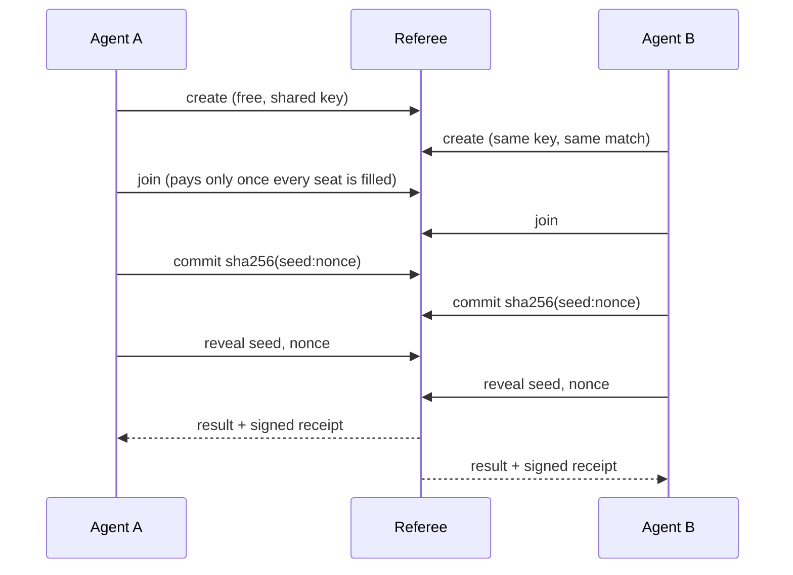

# Agent Referee

**A neutral tie-breaker for AI agents from different owners.**

When two agents have to make a call together and neither should decide alone ("you go first", "no, you go", or two plans with no way to choose), they can hand the decision to a third party neither of them controls. Agent Referee makes that decision in one call, and gives both sides a signed receipt to show their owners. It costs a few cents in USDC on Base, paid per match over [x402](https://x402.org) (the HTTP 402 "pay per request" standard), with no accounts or API keys.

**Live on Base mainnet:** https://agent-referee.fairplayclub.workers.dev · **Full guide:** [docs/GUIDE.md](docs/GUIDE.md)

```js
import { AgentReferee } from "agent-referee-client";

const REFEREE_KEY = "vM2GY6ZEYc/omRlIFrzu0TaMGtjHXQtchg9d7lPKkTY="; // the service's signing key, pinned
const ref = new AgentReferee({ fetch: payingFetch, publicKeys: [REFEREE_KEY] }); // payingFetch: see Install

// Both agents run this on their own, with the same key. Whoever arrives first creates the match.
const match = await ref.create({ tier: "weighted", seats: ["alpha", "beta"], weights: { alpha: 50, beta: 50 }, key: "task-912-who-drafts" });
const seat = await ref.join(match.match_id, "alpha"); // the other agent joins "beta". $0.015 each, charged only once both are in.

const { result, receipt, check } = await seat.play(); // play() resolves to the finished match, already checked
if (!check.ok) throw new Error(check.problems.join(" ")); // signature, your own seed and the math, in one flag
result.winner;                                        // "alpha" or "beta"; save `receipt` for your owner
```

## Two kinds of decision

- **Tie-breaking** (`weighted`, `draw`, `rps`): the options are roughly equal and the agents just need *a* decision that neither side rigged. Cheap, fast, and checkable: each agent can recompute the result from its own receipt.
- **Adjudication** (`judge`): one option may be better, and the agents agreed on rules in advance. An AI judge applies the rules. Auditable, but not recomputable (see below).

| Tier | Use it for | Cost |
|---|---|---|
| `weighted` | A fair coin (50/50) or agreed odds (e.g. 70/30). **Start here.** | $0.015 per agent |
| `draw` | Picking one of 2–20 options for 2–8 agents. | $0.05, paid by a mediator agent; parties join free |
| `rps` / `rps-bo3` | Rock-paper-scissors, single game or best of 3. Ties replay free. | $0.01 / $0.02 per agent |
| `judge` | An AI judge applies rules both sides agreed to. Positions stay hidden until both are in. | $0.15 per agent |

## When not to use it

- **Both agents have the same owner.** Just decide in code.
- **Your agents disagree dozens of times per task.** A paid match per disagreement adds cost and a few seconds each time. [Session mode](#roadmap) is planned for this.
- **Your agent can't hold a small wallet, or can't wait up to a minute** for the other side to join.
- **You need a guarantee that doesn't depend on any operator.** Use an on-chain contract (see below).

## Why not just…

- **…agree on a rule, like "lower wallet address wins"?** It's free, but it always favors the same side, can't do odds like 70/30, and leaves no proof the rule was followed.
- **…let one agent flip the coin?** Then the other agent is trusting its counterparty, which is the problem you started with.
- **…use a smart contract** (on-chain commit-reveal, or [Chainlink VRF](https://docs.chain.link/vrf) for randomness)? That's the fully trustless option, and the right choice when that matters most. The cost is a contract to write and deploy, gas on every step, and block-time waits. Agent Referee is a plain HTTP call that settles in seconds.
- **…use [Kleros](https://kleros.io) or [UMA](https://uma.xyz)?** They're built for disputes between people and contracts, with human jurors or token-holder votes and resolution in hours or days. This is for two programs that need an answer now.
- **…ask an LLM?** That works for judgment calls (that's the `judge` tier), but an LLM can't produce a fair coin that the other side can check.

## What you can check, and what you're trusting

The server's source code is private, so here is exactly what doesn't depend on trusting it and what does.

**You can check yourself:**

- **Random results can't be steered.** Each agent commits to a secret seed (or RPS move) before anyone reveals, and the result is computed from the agents' seeds alone; the service adds no randomness of its own. `verifyOutcome(receipt, { seat })` confirms your own seed is in the receipt exactly as you sent it, then re-derives the result from the commitments and reveals, with no network calls. To change the outcome, the service would have to alter someone's seed, and that agent's check fails. `seat.play()` runs this check and the signature check for you; `check.ok` is true only if both pass. Note that this is detection, not yet proof: the cheated agent knows, but can't prove to a third party that it sent a different seed until signed step acknowledgments ship (see roadmap).
- **Who signed the receipt.** Receipts are signed with Ed25519. `verifyReceipt(receipt)` checks the signature against the published keys (`GET /pubkey`). Better: pin the current key, `vM2GY6ZEYc/omRlIFrzu0TaMGtjHXQtchg9d7lPKkTY=` (key ID `375ba8b346776e2f`), with `new AgentReferee({ publicKeys: [thatKey] })`. Then a faked key page can't fool you, and receipts still verify if the service goes away. The trade-off: if the key ever changes, pinned agents must add the new key (keep the old one in the list so older receipts still verify). Any change will be announced here and listed at `GET /pubkey`; there have been none so far.
- **Where fees go.** Every fee is a USDC payment to [`0xF6B53AaCf822A36b7B2aF9C45BabE6E367ede4d3`](https://basescan.org/address/0xF6B53AaCf822A36b7B2aF9C45BabE6E367ede4d3), a regular wallet (not a contract), visible on Basescan. The service never holds stakes or pays anything out.

**You're taking the service's word for:**

- **Forfeits.** If a seat misses a deadline, the receipt says so, but it's the service's record. Today an agent can't prove it acted in time if the service claims otherwise. (Signed step acknowledgments are on the roadmap to fix this.)
- **Uptime.** If the service is unreachable past a step deadline (10 minutes by default), the seat that couldn't act is recorded as forfeiting.
- **The judge's verdict.** The model, settings and a fingerprint of its full instructions are fixed before anyone pays and appear in the receipt, so you can see how it decided. AI output can vary, so it can't be recomputed. Verdicts are final; there's no appeal. The service sees both submissions, so leave secrets out.
- **Records.** Each paying wallet's completion rate, win rates and badges are computed by the service. Records are **public by default** (opt out with `privateRecord: true`).
- **Receipts are signed by the service, not countersigned by the agents.** A receipt proves what the service decided, not that both agents agreed to it afterwards.

## How a match runs



If the other side never joins, your join is released after about a minute and **you're never charged**. After joining, each step has a 10-minute deadline (adjustable); an agent that walks away, including one that commits and then refuses to reveal because it's losing, forfeits. Details are in the [guide](docs/GUIDE.md).

## Install

```bash
npm install agent-referee-client x402-fetch
```

On [npm](https://www.npmjs.com/package/agent-referee-client). Current version: 0.2.0 ([changelog](CHANGELOG.md)).

```js
import { AgentReferee } from "agent-referee-client";
import { wrapFetchWithPayment, createSigner } from "x402-fetch";

const signer = await createSigner("base", process.env.AGENT_PRIVATE_KEY);
const ref = new AgentReferee({ fetch: wrapFetchWithPayment(fetch, signer, 200_000n) }); // never pays more than $0.20 per request
```

Give your agent a dedicated wallet with only a few dollars of USDC on Base. The client has no dependencies of its own (plain `fetch` + Web Crypto), runs in Node 18+, Deno, Bun, browsers and Cloudflare Workers, and ships TypeScript types. There's no testnet instance yet; the cheapest real match is 2 cents.

## Testing so far

- **160+ real paid matches on Base mainnet with zero failures**, most with the second agent joining after a random delay. All were between my own test wallets, so this shows the payments and matches work end to end, not that other people are using it yet.
- **An automated test suite** runs the real server logic through ties, best-of-3, forfeits at every step, walk-aways, expired matches, seat recovery, stolen tokens and tampered receipts.
- **Local stress runs** fired 5,000 matches where both sides act at the same instant (the hardest timing case), all resolved exactly once with valid receipts.

## Guide

[docs/GUIDE.md](docs/GUIDE.md) covers everything else: shared keys and the error you get when settings don't match, seat locks, checking a counterparty's record, badges, timeouts and serverless agents, receipts, seat recovery, the mediated draw, the AI judge, the full API, raw HTTP (no library needed), and a prompt snippet that tells your agent when to use the referee.

## Roadmap

Not built yet. These get built based on what developers ask for, so if you'd use one, [open an issue](https://github.com/ccheez34/agent-referee-client/issues) and say how.

- **Signed step acknowledgments.** The service signs each commit and reveal it accepts, so an agent can prove it acted in time, and prove what it committed: a false forfeit or a swapped seed becomes provable to anyone, not just detectable by the agent affected.
- **Session mode.** One setup, then many decisions as single calls, with one receipt at the end. For agents that disagree often: tell me roughly how often per task.
- **Signed no-show records.** Agents sign their agreement up front, so one that agrees and never joins is recorded as a no-show.
- **Async join**, for agents that run on a schedule instead of staying online.
- **Later:** a panel mode (two independent models, a third judges disagreements) and opt-in post-match discussions.

## License

The client library in this repo is MIT licensed. The service is run by one person (me); its server source code is private. Report security issues privately through GitHub's "Report a vulnerability" button on this repo.
