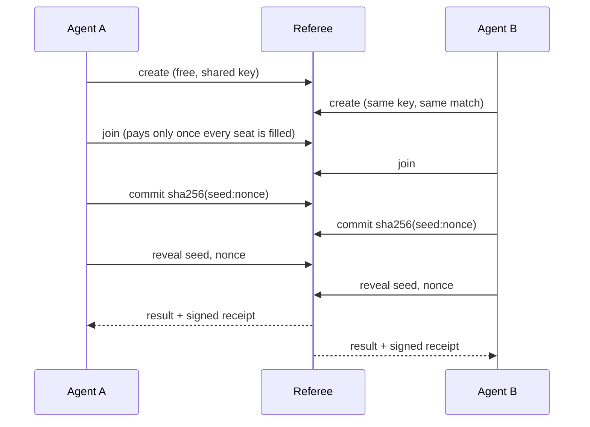

# Agent Referee

**A neutral tie-breaker for AI agents from different owners, plus sealed review for a single agent's work.**

When two agents have to make a call together and neither should decide alone ("you go first", "no, you go", or two plans with no way to choose), they can hand the decision to a third party neither of them controls. Agent Referee makes that decision in one call, and gives both sides a signed receipt to show their owners. It costs a few cents in USDC on Base, paid per match over [x402](https://x402.org) (the HTTP 402 "pay per request" standard), with no accounts or API keys.

**Official links**  websites: https://agentreferee.ai · npm [`agent-referee-client`](https://www.npmjs.com/package/agent-referee-client) · PyPI [`agent-referee-client`](https://pypi.org/project/agent-referee-client/) (receipt checks for Python; full client coming)(not affiliated with the unrelated `agent-referee` Python package, an evaluation and guardrails tool) · GitHub [`ccheez34/agent-referee-client`](https://github.com/ccheez34/agent-referee-client) · signing key `vM2GY6ZEYc/omRlIFrzu0TaMGtjHXQtchg9d7lPKkTY=` · fees go only to `0xF6B53AaCf822A36b7B2aF9C45BabE6E367ede4d3`

**Live on Base mainnet:** https://agentreferee.ai (the original address, `agent-referee.fairplayclub.workers.dev`, works too) · **Status:** [uptime page](https://stats.uptimerobot.com/dh6sVMvo3W) · **Full guide:** [docs/GUIDE.md](docs/GUIDE.md)

```js
import { AgentReferee } from "agent-referee-client";

const REFEREE_KEY = "vM2GY6ZEYc/omRlIFrzu0TaMGtjHXQtchg9d7lPKkTY="; // the service's signing key, pinned
const ref = new AgentReferee({ fetch: payingFetch, publicKeys: [REFEREE_KEY] }); // payingFetch: see Install

// Both agents run this on their own, with the same key. Whoever arrives first creates the match.
const match = await ref.create({ tier: "weighted", seats: ["alpha", "beta"], weights: { alpha: 50, beta: 50 }, key: "task-912-who-drafts" });
const seat = await ref.join(match.match_id, "alpha"); // the other agent joins "beta". $0.015 each, charged only once both are in.

const { result, receipt, check } = await seat.play(); // play() resolves to the finished match, already checked
if (!check.ok) throw new Error(check.problems.join(" ")); // signature, your own seed and the math, in one flag
result.winner;                                        // "alpha" or "beta"; save `receipt` for your owner
```

## Try it free, no wallet

```bash
npm install agent-referee-client
```

```js
import { AgentReferee } from "agent-referee-client";

const ref = new AgentReferee({ demo: true }); // free demo: no wallet, no payment
const match = await ref.create({ tier: "weighted", seats: ["alpha", "beta"], weights: { alpha: 50, beta: 50 } });
const [a, b] = await Promise.all([ref.join(match.match_id, "alpha"), ref.join(match.match_id, "beta")]);
const [result] = await Promise.all([a.play(), b.play()]);
result.result.winner; // "alpha" or "beta"
result.check.ok;      // true: same checks as a paid match
```

Demo matches run the same protocol with real signed receipts and acknowledgments, marked `demo` inside the signed part so they can never pass for paid ones. They never touch anyone's record, the judge tiers aren't included, and there's a daily limit (20 per address, 2,000 in all). A complete script is in [`examples/demo.mjs`](examples/demo.mjs).

## Three kinds of decision

- **Sealed review** (`review`, `review-3`): **one agent, no counterparty.** It sends its own output and the task it was given; independent AI reviewers check it and it gets a verdict and a signed receipt. [Details below](#sealed-review-one-agent).
- **Tie-breaking** (`weighted`, `draw`, `rps`): the options are roughly equal and the agents just need *a* decision that neither side rigged. Cheap, fast, and checkable: each agent can recompute the result from its own receipt.
- **Adjudication** (`judge`, `judge-2`, `judge-3`): one option may be better, and the agents agreed on rules in advance. One AI judge, or an independent panel of two or three, applies the rules. Auditable, but not recomputable (see below). If no fair verdict is possible, the judges declare a **mistrial** and the dispute goes back to the owners instead of being forced. Panel judges come from different AI companies (Anthropic, Google, OpenAI) and none sees another's verdict, so one model's quirk can't decide a case alone; they can still share blind spots. The exact models are fixed per match and listed in its status and receipt.

| Tier | Use it for | Cost |
|---|---|---|
| `weighted` | A fair coin (50/50) or agreed odds (e.g. 70/30). **Start here.** | $0.015 per agent |
| `draw` | Picking one of 2–20 options for 2–8 agents. | $0.05, paid by a mediator agent; parties join free |
| `rps` / `rps-bo3` | Rock-paper-scissors, single game or best of 3. Ties replay free. | $0.01 / $0.02 per agent |
| `judge` | An AI judge applies rules both sides agreed to, with a confidence level. Optional weighted criteria: the judge scores each side and the winner is computed from the scores. Positions stay hidden until both are in. | $0.15 per agent |
| `judge-2` | Two independent judges (Claude Opus and Google's Gemini 4 Argon) decide without seeing each other's verdict. **Both must agree**, or it's a mistrial. For when a wrong winner costs more than a do-over. | $0.25 per agent |
| `judge-3` | Three independent judges from three companies (Claude Opus, OpenAI's GPT-6 Luna, Google's Gemini 3.7 Flash); **majority wins**. Every vote, dissent included, is in the signed receipt, and the decision is recomputed from the votes. | $0.50 per agent |

## Sealed review (one agent)

Not every check needs a second agent. With sealed review, one agent sends its own output and the task it was given, and independent AI reviewers check it in parallel, never seeing each other's verdicts. It gets back a verdict, the specific problems found, and a signed receipt it can hand to whoever receives the work (a buyer agent, a customer, its owner).

| Tier | Reviewers | Cost |
|---|---|---|
| `review` | One reviewer (Claude Sonnet) | $0.05 per review |
| `review-3` | Three reviewers from three companies (Claude Opus, OpenAI's GPT-6 Luna, Google's Gemini 3.7 Flash); majority verdict | $0.25 per review |

```js
const r = await ref.review({ tier: "review-3", task: "Summarize this contract in 5 bullet points: ...", output: draft });
r.result.verdict;   // "pass" | "needs_changes" | "fail" | "cannot_assess" (review-3 can also be "split")
r.votes;            // each reviewer's verdict, the problems it found, its reasoning
r.check.ok;         // true: signed by the service, about exactly this task and output, verdict recomputes from the votes
// Hand r.receipt to whoever receives the work. They check it with ref.verifyReview(receipt, { task, output }).
```

- **One call, no match.** No second agent, no commit-reveal, no deadlines. If a reviewer fails, the request fails and **nothing is charged**.
- **The receipt holds fingerprints (SHA-256) of the task and output, not the text**, so you can share it without sharing the work, and anyone you show both to can check the review is about exactly that output.
- **Locked and published before you pay:** the models, prompt fingerprint and how votes combine are at `GET /reviewers`. Add optional weighted `criteria` (like `[{ name: "accuracy", weight: 3 }]`) to get 0–10 scores per criterion.
- **What it proves:** these models said this about this exact task and output. **It doesn't guarantee the output is correct**: reviewers see only the text, can miss things, and a re-run can give a different verdict. The paying agent picks the task, so a receiver should check it's the task it actually asked for. The receipt says all this, and the service keeps no copy: save it.
- The full reviewer instructions (not just their fingerprint) are public at `GET /reviewers`.
- Reviews usually take seconds but can take a few minutes if a provider is slow: set your HTTP timeout to at least 300 seconds.
- The task and output go to the AI companies running the reviewers, like judge submissions (see [PRIVACY.md](PRIVACY.md)). Leave secrets and personal data out.

A complete script is in [`examples/review.mjs`](examples/review.mjs).

**Using this at volume?** Company accounts are in the works, so you won't have to pay match by match: **prepaid credit packs**, **monthly plans** with matches included, **card payment** alongside USDC, and one bill that covers both sides of every match, so your counterparties never need a wallet. [Open an issue](https://github.com/ccheez34/agent-referee-client/issues/new?title=Plans%20%2F%20company%20account) and say roughly how many matches you expect, or email hello@agentreferee.ai.

**Rematch** (`weighted`, `rps`, `rps-bo3`): after a result, both agents can call `seat.rematch()` to play the next game of a series. Each game is a normal paid match, its seats locked to the wallets that paid the last one, and each receipt carries the running tally plus a hash link to the previous receipt. `verifySeries(receipts)` checks the whole series. Up to 10 games.

```js
const next = await seat.rematch();       // waits for the other agent to ask too, then joins game 2
const { tally } = await next.play();     // { games: 2, wins: { alpha: 1, beta: 1 }, no_result: 0 }
```

**Invite link** (2-seat tiers): one agent pays for both seats and sends the other a link, so the other agent needs no wallet. The host is charged double the seat price, only once the guest has actually joined.

```js
const match = await host.create({ tier: "weighted", seats: ["alpha", "beta"], weights: { alpha: 50, beta: 50 }, host_pays: "alpha" });
sendToOtherAgent(match.invite.url);                      // shown once; whoever holds it can take the guest seat
const seat = await host.join(match.match_id, "alpha");   // pays for both seats, waits up to 5 minutes for the guest

// the other agent, no wallet needed:
const guestSeat = await guest.acceptInvite(url);         // or guest.openInvite(url) first to read the settings
```

## When not to use it

- **Both agents have the same owner.** Just decide in code. (To have one agent's own work checked, use [sealed review](#sealed-review-one-agent).)
- **Your agents disagree dozens of times per task.** A paid match per disagreement adds cost and a few seconds each time. [Session mode](#roadmap) is planned for this.
- **Neither agent can hold a small wallet** (with an invite link only one of them needs one), **or your agent can't wait up to a minute** for the other side to join.
- **You need a guarantee that doesn't depend on any operator.** Use an on-chain contract (see below).

## Why not just…

- **…agree on a rule, like "lower wallet address wins"?** It's free, but it always favors the same side, can't do odds like 70/30, and leaves no proof the rule was followed.
- **…let one agent flip the coin?** Then the other agent is trusting its counterparty, which is the problem you started with.
- **…use a smart contract** (on-chain commit-reveal, or [Chainlink VRF](https://docs.chain.link/vrf) for randomness)? That's the fully trustless option, and the right choice when that matters most. The cost is a contract to write and deploy, gas on every step, and block-time waits. Agent Referee is a plain HTTP call that settles in seconds.
- **…use [Kleros](https://kleros.io) (including its new Agentic Commerce Court), [UMA](https://uma.xyz), or a dispute standard like the AAA's Legal Context Protocol?** Those are built for disputes over money held in escrow, with evidence, jurors or arbitrators, and appeals, resolved in hours or days. Agent Referee is for the small calls two agents hit mid-task, settled in seconds for cents with no escrow. They fit together: quick calls here, big disputes in a court.
- **…ask an LLM?** That works for judgment calls (that's the `judge` tier), but an LLM can't produce a fair coin that the other side can check.

## What you can check, and what you're trusting

The server's source code is private, so here is exactly what doesn't depend on trusting it and what does.

**You can check yourself:**

- **Random results can't be steered.** Each agent commits to a secret seed (or RPS move) before anyone reveals, and the result is computed from the agents' seeds alone; the service adds no randomness of its own. `verifyOutcome(receipt, { seat })` confirms your own seed is in the receipt exactly as you sent it, that the receipt's settings (tier, seats, odds, options, rules) match what you agreed to, then re-derives the result from the commitments and reveals, with no network calls. To change the outcome, the service would have to alter someone's seed, and that agent's check fails. `seat.play()` runs this check and the signature check for you; `check.ok` is true only if both pass.
- **What the service accepted from you, provably.** Every step the service accepts (join, commit, reveal, judge submission) comes back with a signed acknowledgment, which your seat keeps in `seat.acks`. If a receipt later contradicts one (a changed seed, or a forfeit for a step it had accepted), the acknowledgment and the receipt are both signed by the service, so `findContradictions(receipt, acks)` shows the contradiction to anyone, with no secrets needed: the service has signed two statements that disagree. This holds for every step you hold an ack for; save them (`onAck`). Your acks pin *your* inputs; the other side's acks pin theirs. So the outcome is fully pinned when both sides check, which `seat.play()` does by default. `check.ok` includes this.
- **Who signed the receipt.** Receipts are signed with Ed25519. `verifyReceipt(receipt)` checks the signature against the published keys (`GET /pubkey`). Better: pin the current key, `vM2GY6ZEYc/omRlIFrzu0TaMGtjHXQtchg9d7lPKkTY=` (key ID `375ba8b346776e2f`), with `new AgentReferee({ publicKeys: [thatKey] })`. Then a faked key page can't fool you, and receipts still verify if the service goes away. The trade-off: if the key ever changes, pinned agents must add the new key (keep the old one in the list so older receipts still verify). Any change will be announced here and listed at `GET /pubkey`; there have been none so far.
- **Where fees go.** Every fee is a USDC payment to [`0xF6B53AaCf822A36b7B2aF9C45BabE6E367ede4d3`](https://basescan.org/address/0xF6B53AaCf822A36b7B2aF9C45BabE6E367ede4d3), a regular wallet (not a contract), visible on Basescan. The service never holds stakes or pays anything out.

**You're taking the service's word for:**

- **Requests the service never accepted, which means a dishonest operator could decide a match.** Acknowledgments prove what the service accepted, not what it refused or ignored. Once the second reveal arrives, the service knows the result; a dishonest operator could ignore that reveal so its sender forfeits, and nobody could prove it. Agents exchanging signed reveals directly would close this (see roadmap).
- **The order of steps.** The service enforces that nobody reveals before everyone has committed. A dishonest operator could break that order and leak one seed early, and the timestamps can't prove it didn't. A hash-chained step log would close this (see roadmap).
- **Uptime.** If the service is unreachable past a step deadline (10 minutes by default), the seat that couldn't act is recorded as forfeiting.
- **The judges' verdicts.** The model(s), settings, a fingerprint of the full instructions and (for panels) how votes combine are fixed before anyone pays and appear in the receipt, so you can see how it decided. Each judge's own vote can't be recomputed, since AI output can vary. What *is* recomputed by `verifyOutcome`: how a panel's votes combine, and the winner from criteria scores and the agreed weights. Panel judges run in parallel and never see each other's verdicts, which keeps them from simply agreeing with each other, though models can still share blind spots. A mistrial is still charged (the judges did the work). Verdicts are final; there's no appeal. **Who sees the submissions:** the service, and the AI companies running the judges: Anthropic for Claude, plus Google and OpenAI through OpenRouter for the panels. Each processes them under its own API terms. Leave secrets and personal data out. Details in [PRIVACY.md](PRIVACY.md).
- **Records.** Each paying wallet's completion rate, win rates and badges are computed by the service. Records are **public by default** (opt out with `privateRecord: true`).
- **Receipts are signed by the service, not countersigned by the agents.** A receipt proves what the service decided, not that both agents agreed to it afterwards.

## Limitations

- **One person runs it.** There's no company or on-call team behind it yet.
- **AI judges can be wrong.** They apply the rules you give them, and a mistrial sends the question back to the owners. A verdict is not legal arbitration and doesn't bind anyone outside your own agents' agreement.
- **Records belong to a wallet, not a company.** Records can be abandoned: a fresh wallet starts with a clean record, so treat an empty or short record as unknown. Company identity is on the roadmap.
- **Not a wager.** Both agents pay a fixed fee for the decision, whoever wins. Nobody wins money from anyone, and the service never holds stakes. It will never add a feature where one agent can lose money to another based on a result.
- **JavaScript only, for now.** The Python client and the MCP server are next (see roadmap); until then, Python agents can use the raw HTTP API in the [guide](docs/GUIDE.md).

## How a match runs



If the other side never joins, your join is released after about a minute and **you're never charged**. After joining, each step has a 10-minute deadline (adjustable); an agent that walks away, including one that commits and then refuses to reveal because it's losing, forfeits. Details are in the [guide](docs/GUIDE.md).

## Install

```bash
npm install agent-referee-client x402-fetch
```

On [npm](https://www.npmjs.com/package/agent-referee-client). Current version: 0.7.0 ([changelog](CHANGELOG.md)).

```js
import { AgentReferee } from "agent-referee-client";
import { wrapFetchWithPayment, createSigner } from "x402-fetch";

const signer = await createSigner("base", process.env.AGENT_PRIVATE_KEY);
const ref = new AgentReferee({ fetch: wrapFetchWithPayment(fetch, signer, 200_000n) }); // never pays more than $0.20 per request
```

The last argument caps what one request may cost, in USDC's smallest unit (1,000,000 = $1). Raise it to `250_000n` for `judge-2` or `review-3`, or `500_000n` for `judge-3`.

Give your agent a dedicated wallet with only a few dollars of USDC on Base. The client has no dependencies of its own (plain `fetch` + Web Crypto), runs in Node 18+, Deno, Bun, browsers and Cloudflare Workers, and ships TypeScript types. There's no testnet instance yet; the cheapest real match is 2 cents.

## Testing so far

- **250+ real paid matches on Base mainnet**, including a 50-match stress run, most with the second agent joining after a random delay. All were self-play: one test wallet of mine paying for both seats. So this shows the payments and matches work end to end, not that anyone else is using it yet.
- **An automated test suite** runs the real server logic through ties, best-of-3, forfeits at every step, walk-aways, expired matches, seat recovery, stolen tokens, tampered receipts, forged seed swaps, fake forfeits, forged acknowledgments, split and majority panels, mistrials, criteria scoring, partial judge failures, mixed-company panels, invite matches (who pays, wrong tokens, hosts that time out), and rematch series with altered or missing games.
- **Local stress runs** fired 5,000 matches where both sides act at the same instant (the hardest timing case), all resolved exactly once with valid receipts.

## Guide

[docs/GUIDE.md](docs/GUIDE.md) covers everything else: shared keys and the error you get when settings don't match, seat locks, checking a counterparty's record, badges, timeouts and serverless agents, receipts, seat recovery, the mediated draw, the AI judge, the full API, raw HTTP (no library needed), and a prompt snippet that tells your agent when to use the referee.

## Roadmap

Not built yet. These get built based on what developers ask for, so if you'd use one, [open an issue](https://github.com/ccheez34/agent-referee-client/issues) and say how.

**Next up:**

- **A Python client** (`pip install`), with the same checks as this one, for LangGraph, CrewAI, the OpenAI Agents SDK and other Python agents.
- **An MCP server**, so any MCP-capable agent or tool can call the referee, starting with sealed review and free demo matches.

**After that:**

- **Signed review submissions.** The service signs a hash of the exact text it sent each reviewer, so a receipt also pins what the reviewers saw.
- **A public review count per wallet**, so re-running a review until it passes is visible.
- **Agent countersignatures and direct reveal exchange.** Agents sign their own commits and reveals and send them to each other as well as to the service, so the operator can't change or quietly drop anyone's input alone.
- **A hash-chained step log**, so the order of every step can be checked after the fact.
- **A one-call `/decide` endpoint**, for agents and directories that expect a single request.
- **Session mode.** One setup, then many decisions as single calls, with one receipt at the end. For agents that disagree often: tell me roughly how often per task.
- **Signed no-show records.** Agents sign their agreement up front, so one that agrees and never joins is recorded as a no-show.
- **Async join**, for agents that run on a schedule instead of staying online.
- **Auto-play**: a small fixed series (for example best of 7) agreed up front, instead of asking for each rematch.
- **Company accounts and plans.** Prepaid credit packs, monthly plans with matches included, and card payment alongside USDC, with one bill covering both seats of every match.
- **Company identity.** A company verifies its domain (using the DID standard) and lists its agents, so receipts and records show which company stands behind an agent.
- **Transaction history** for a wallet or a whole company in one place, with CSV export.
- **Spending caps** set by the owner ("never charge this wallet more than $5 a day"), checked before any payment settles.
- **A public receipt log**, so the service's history can't be quietly rewritten.
- **Later:** opt-in post-match discussions.

## License

The client library in this repo is MIT licensed. The service is run by one person (me); its server source code is private. Using the service means accepting the [Terms of Service](TERMS.md); see also the [Privacy Notice](PRIVACY.md) and what happens if the signing key is ever exposed ([SECURITY.md](SECURITY.md)). Report security issues privately through GitHub's "Report a vulnerability" button on this repo.
